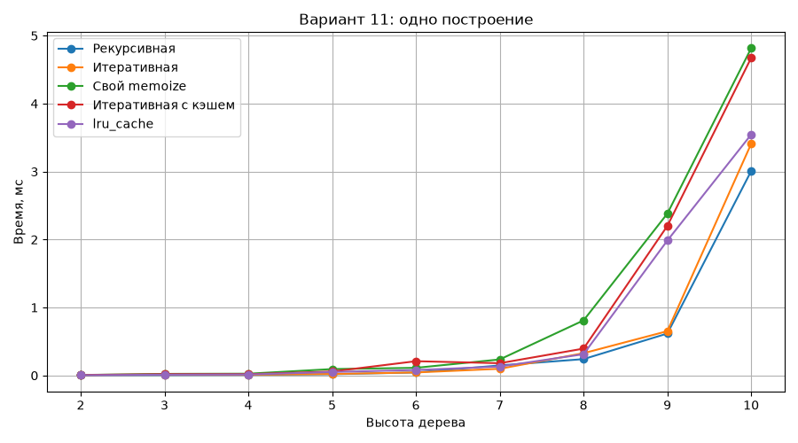
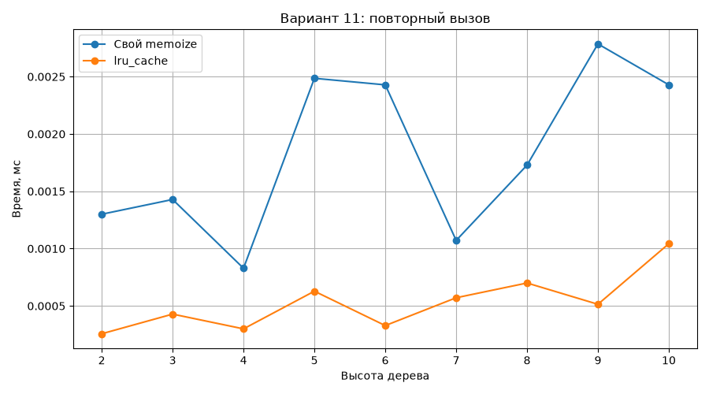
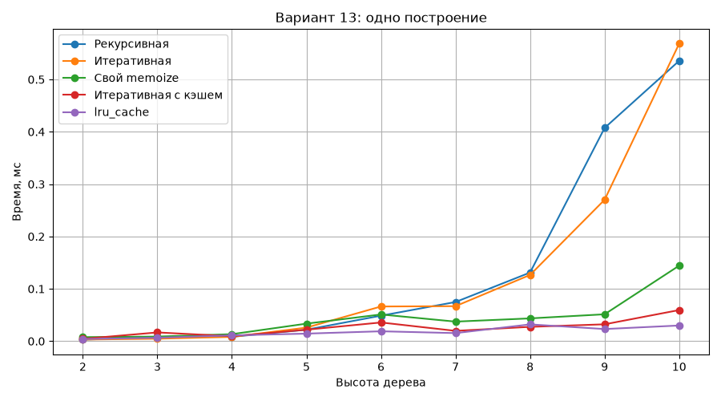
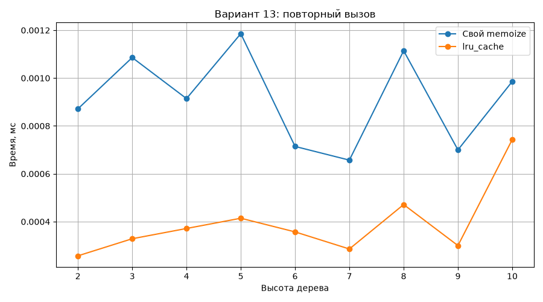

# Лабораторная работа. Мемоизация бинарного дерева

**Вариант 11**, сравнение с вариантом 13.

## Задача

Сравнить построение бинарного дерева с мемоизацией и без неё. Дерево хранится в словаре с ключами `value`, `left`, `right`.

- Вариант 11: `root=11`, `height=3`, слева `x**2`, справа `2 + x**2`.
- Вариант 13: `root=13`, `height=3`, слева `x+1`, справа `x-1`.

## Решение

В `app.py` находятся пять функций: обычные рекурсивная и итеративная (из ЛР 3 и 4), рекурсивная с `@memoize`, итеративная с локальным словарём и рекурсивная с `@lru_cache(maxsize=None)`. Декоратор `memoize` использует `wraps`, учитывает `*args` и `**kwargs`, считает `hits` и `misses` и позволяет очищать кэш через `cache_clear()`.

В `benchmark.py` используется `timeit`: 7 запусков для каждой высоты **от 2 до 10**. Перед замерами одного построения кэш очищается. Для повторного вызова сначала строится дерево, затем замеряется следующий вызов с теми же аргументами. При высоте 10 в варианте 11 возможен `OverflowError` из-за больших чисел; при высоте 9 обычное построение укладывается в 1 секунду.

## Результаты

Среднее время одного построения (мс):

| Вариант | Высота | Рекурсивная | Итеративная | `memoize` | Итеративная с кэшем | `lru_cache` |
|---|---:|---:|---:|---:|---:|---:|
| 11 | 2 | 0.0033 | 0.0038 | 0.0054 | 0.0058 | 0.0027 |
| 11 | 5 | 0.0141 | 0.0152 | 0.0345 | 0.0398 | 0.0189 |
| 11 | 9 | 0.2512 | 0.3680 | 0.5310 | 0.8120 | 0.2670 |
| 13 | 2 | 0.0022 | 0.0026 | 0.0041 | 0.0037 | 0.0020 |
| 13 | 5 | 0.0114 | 0.0120 | 0.0130 | 0.0102 | 0.0058 |
| 13 | 9 | 0.2243 | 0.2246 | 0.0670 | 0.0643 | 0.0164 |

Повторный вызов на высоте 9 (мс):

| Вариант | `memoize` | `lru_cache` |
|---|---:|---:|
| 11 | 0.000950 | 0.000380 |
| 13 | 0.000551 | 0.000185 |

Количество вызовов из функций `left_leaf` и `right_leaf` при высоте 9:

| Вариант | Без кэша | С кэшем |
|---|---:|---:|
| 11 | 511 | 425 |
| 13 | 511 | 45 |

После построения варианта 13 с `lru_cache` при высоте 9: `CacheInfo(hits=36, misses=55, maxsize=None, currsize=55)`.

## Графики









## Запуск

```bash
pip install matplotlib
python -m unittest test_app.py -v
python benchmark.py
